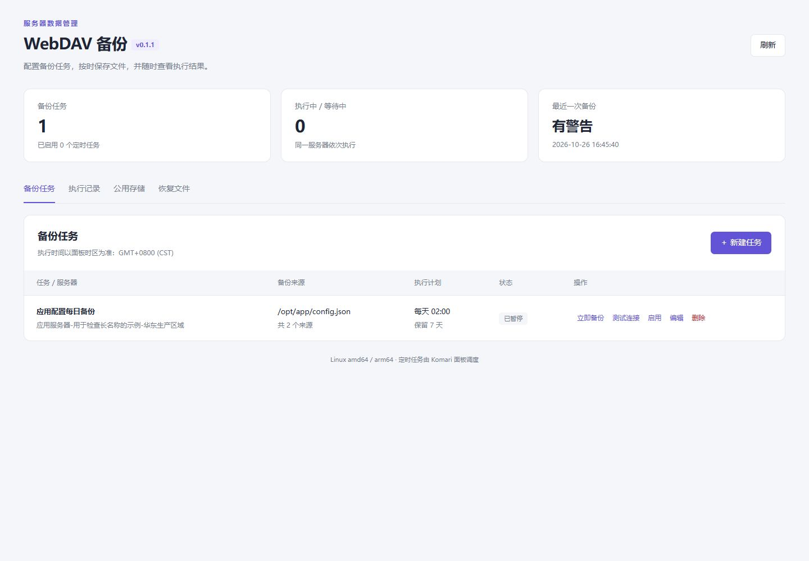

# Komari WebDAV 备份

在 Komari 后台集中管理 Linux 服务器的文件备份：配置一套 WebDAV，选择服务器，分别设置备份来源、执行时间和保留天数，并通过 Komari 接收执行结果通知。

[下载插件](https://github.com/DeserveL/komari-webdav-backup/releases/latest) · [更新记录](CHANGELOG.md) · [问题反馈](https://github.com/DeserveL/komari-webdav-backup/issues) · [验证记录](docs/TESTING.md)



## 主要功能

- **统一配置**：多台服务器共用一套 WebDAV，支持批量创建任务。
- **独立任务**：每台服务器可创建多个任务，支持文件、目录和排除规则。
- **定时备份**：每天或每周执行，也可随时手动备份；离线恢复后合并补跑。
- **保留清理**：按任务保留天数清理，仅处理本插件生成的备份，至少保留最近一份完整成功备份。
- **执行记录**：查看阶段、耗时、归档大小、远端位置、摘要和失败原因。
- **结果通知**：复用 Komari 已配置的通知通道，无需重复填写 Telegram 或邮件配置。

大文件由目标服务器直接上传 WebDAV。执行器按需启动，无额外常驻服务，也无需在每台服务器安装 Node.js、Go 或 Python。

## 环境要求

| 项目 | 要求 |
| --- | --- |
| Komari 服务端 | 最低 1.6.1，已验证基线为 1.6.1 / MoeJS |
| Agent | 协议基线为 1.5.11；需开启远程控制，并拥有备份来源的读取权限 |
| 目标服务器 | Linux amd64 / arm64；首次部署需有 `curl` 或 `wget`，以及 `sha256sum` 或 `shasum` |
| 网络 | 节点可访问面板和 WebDAV 的 HTTPS 地址，证书校验通过 |
| WebDAV | 支持 MKCOL、PUT、HEAD、GET、PROPFIND、DELETE |

当前专注普通文件与目录的完整归档，不提供数据库一致性备份、应用快照、增量备份、归档加密或自动恢复。Windows 节点不在支持范围内。具体已验证与待验证场景见 [验证记录](docs/TESTING.md)。

## 安装配置

1. 前往 [Releases](https://github.com/DeserveL/komari-webdav-backup/releases/latest)，下载 **`komari-webdav-backup-<版本>.zip`**。这是可安装插件；`-source.zip` 和 GitHub 自动生成的源码归档用于开发。
2. 在 Komari「插件管理」上传 ZIP，核对权限后启用插件。
3. 打开「WebDAV 备份 → 公用存储」，填写面板地址、WebDAV 地址和专用账号，保存后点击「测试 WebDAV 连接」。
4. 新建任务，选择服务器，填写需要备份的文件或目录，每行一个 Linux 绝对路径。
5. 点击任务的「测试连接」或执行一次手动备份；确认成功后再点击「启用」，开启定时备份。
6. 如需通知，先在 Komari 中启用全局通知并配置通道，再打开任务的通知开关。

### 配置示例

| 配置项 | 示例 |
| --- | --- |
| 面板地址 | `https://monitor.example.com` |
| WebDAV 地址 | `https://dav.example.com/dav` |
| 基础目录 | `komari-backups` |
| 任务备份来源 | `/opt/app/config.json`、`/opt/app/data`，分两行填写 |
| 任务远端子目录 | `production`，可留空 |
| 排除规则 | `**/*.log`、`opt/app/cache/**`，每行一条 |

排除规则匹配去掉开头 `/` 的原始路径：`*` 匹配单层，`?` 匹配单字符，`**` 可跨目录。不支持正则或否定规则。

### 默认策略

| 项目 | 默认值 |
| --- | --- |
| 新任务状态 | 暂停，测试通过后手动启用 |
| 计划时间 | 每天 02:00，以 Komari 服务端时区为准 |
| 远端保留 | 7 天；`0` 表示不自动清理 |
| 并发 | 最多同时备份 2 台服务器；同一服务器串行执行 |
| 任务超时 | 120 分钟，可配置为 5～1440 分钟 |

容器部署时，请正确设置 Komari 的 `TZ`。面板停机期间不派发新任务，恢复后只补跑最近一个错过的计划。通知仍受 Komari 全局开关、通道和模板控制。

## 备份与恢复

### 远端目录

```text
WebDAV 地址 / 基础目录 / 任务远端子目录 / 节点 UUID / 任务 ID / 运行 ID /
├── backup.tar.gz
└── manifest.json
```

这些层级用于隔离不同服务器、任务和每次运行，属于正常设计。节点 UUID 和任务 ID 保持稳定，重命名不会改变已有备份的归属。清理只删除验证通过的归档和清单，空运行目录可能保留。

清单记录来源、完成时间、归档大小、SHA-256 和警告。归档上传、大小检查和完成清单验证通过后，才记录上传完成。**恢复可用性还需通过下载、校验和解压确认。**

### 手动恢复

使用 WebDAV 客户端下载同一运行目录中的 `backup.tar.gz` 和 `manifest.json`，将摘要与清单中的 `sha256` 对比，然后解压到新的空目录：

```sh
sha256sum backup.tar.gz
tar -tzf backup.tar.gz
mkdir restored
tar -xzf backup.tar.gz -C restored
```

例如 `/opt/app/config.json` 会解压到 `restored/opt/app/config.json`。确认内容、权限、修改时间和符号链接目标后，再恢复到业务位置。运行中的数据库请使用数据库自身的导出或快照工具。

## 升级与数据保留

在 Komari「插件管理」上传新版插件 ZIP **覆盖安装**，完成后刷新页面。不要先删除插件或清理插件数据目录。

0.1.1 已通过本地官方 Komari 安装接口的覆盖升级检查，任务、公用凭据、历史记录和原启停状态均保留；远端备份无需迁移。修改公用存储配置后，已有定时任务会暂停，重新测试后可启用。

迁移面板或备份插件配置时，需要同时保留长期插件数据目录中的 **`master.key` 和 `state.enc.json`**，具体路径及凭据边界见 [运行与安全说明](docs/USAGE.md)。

## 开发与文档

构建要求 Node.js 20+、Go 1.24+。执行器仅使用 Go 标准库，npm 包用于开发和打包，不作为插件运行时依赖。隔离 Komari 检查脚本另需 Node.js 22+。

```sh
git clone https://github.com/DeserveL/komari-webdav-backup.git
cd komari-webdav-backup
npm ci
npm test
cd runner
go test ./...
go vet ./...
cd ..
npm run build
```

构建结果位于 `release/`：插件安装包、源码包及 `SHA256SUMS`。`GO_EXE` 可指定 Go 可执行文件。GitHub Actions 检查 Linux 测试、静态检查、打包和官方 Komari 运行时；版本标签触发 Release 构建。

- [运行与安全说明](docs/USAGE.md)：调度、中断、文件语义、权限、凭据和迁移。
- [API 文档](docs/API.md)：管理接口、执行器授权和完成清单。
- [验证记录](docs/TESTING.md)：测试方法、截图及覆盖范围。
- [更新记录](CHANGELOG.md)：版本变化。

遇到问题可提交 [Issue](https://github.com/DeserveL/komari-webdav-backup/issues)，附上版本、节点架构、失败阶段和脱敏后的错误信息。请勿上传运行凭据、密钥、状态文件或完整授权命令。

## 开源协议

[MIT](LICENSE)。执行器包含的 Go 标准库许可证见 [Go LICENSE](docs/GO-LICENSE.txt)。Komari 为独立项目，本插件不属于 Komari 官方项目。
